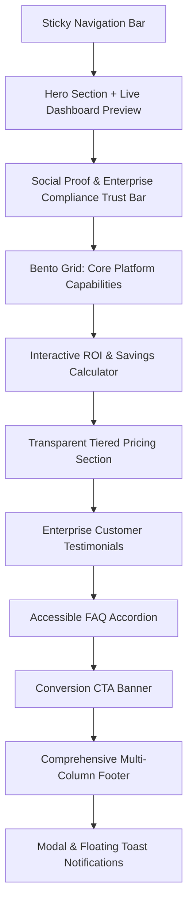

# Design Specification: NovaFlow FinTech SaaS Landing Page

- **Date:** 2026-09-24
- **Project:** NovaFlow — Intelligent Financial Operations & Global Treasury Platform
- **Target Audience:** Finance Directors, CFOs, FinTech Developers, Enterprise Treasury Managers
- **Tech Stack:** Semantic HTML5, Modular CSS3 (Design Tokens, Grid, Flexbox), Pure Vanilla JavaScript (ES6+ Modules)
- **Zero-Dependency Guarantee:** 100% Native Web Standards. Zero external runtime UI/charting frameworks.

---

## 1. Executive Summary & Goals

NovaFlow is an enterprise-grade FinTech SaaS landing page engineered to showcase **Senior Frontend Craftsmanship**. The design embodies the aesthetic of world-class financial technology leaders (such as Wise, Revolut, Stripe, and Mercury), marrying a crisp, high-contrast **Clean Corporate Light** theme with full **Dark Mode** parity.

### Primary Objectives
1. **Uncompromising Visual Polish:** Clean corporate aesthetic with intentional typography, pixel-perfect borders, subtle ambient glow, and high-performance micro-interactions.
2. **Senior-Level Architecture:** Modular codebase adhering to separation of concerns (CSS tokens/modules, ES6 module architecture, event-driven reactive state).
3. **Interactive Showcase:** Dynamic components including a live financial dashboard with a custom vanilla SVG chart engine, an interactive ROI/savings calculator, a monthly/annual pricing calculator, an accessible accordion FAQ, and a focus-trapped demo booking modal.
4. **WAI-ARIA Accessibility & Performance:** WCAG 2.1 AA compliant contrast ratios, full keyboard navigation, `prefers-reduced-motion` respect, zero Flash of Unstyled Content (FOUC), and 60fps animations.

---

## 2. Information Architecture & Section Hierarchy

The landing page follows a structured narrative designed for enterprise conversion:



### 2.1 Section Details

1. **Sticky Header & Navigation Bar:**
   - **Branding:** Geometric vector SVG NovaFlow brand mark with wordmark.
   - **Navigation Items:** Products, Solutions, Calculator, Pricing, FAQ.
   - **Action Bar:**
     - Theme Toggle Button (accessible Sun/Moon icon toggle).
     - Sign In link.
     - "Book a Demo" CTA button (opens accessible modal).
   - **Mobile Drawer:** Accessible responsive slide-out menu with smooth backdrop blur.

2. **Hero Section:**
   - **Badge:** `✨ NovaFlow 3.0 is live • Real-Time Global Treasury Engine`
   - **Headline:** *"Financial Operations, Engineered for Hypergrowth."*
   - **Subheadline:** *"Automate reconciliation, execute instant cross-border payouts, and monitor global multi-currency liquidity in real-time. All from a single unified API and intelligent treasury platform."*
   - **CTA Group:** Primary button *"Start Free Trial"* + Secondary button *"Explore Interactive Demo"* with microcopy *"No credit card required • SOC2 Type II Certified"*.
   - **Interactive Live Dashboard Preview Widget:**
     - Global Treasury Balance display: `$12,458,920.40` with 24h delta `+14.8%`.
     - Timeframe Tabs: **7D**, **30D**, **1Y** with an animated sliding indicator.
     - Responsive SVG Area Chart with smooth bezier curves and linear gradient fill.
     - Quick KPI Pills: Auto-reconciliation (99.4%), Payout Latency (1.2s), Currencies (38+).

3. **Social Proof & Compliance Bar:**
   - Client trust logos (mock fintech/tech enterprises).
   - Compliance badges: **SOC2 Type II**, **ISO 27001**, **PCI-DSS Level 1**.

4. **Bento Grid: Core Capabilities:**
   - **Card 1 (Hero / Double-width):** Real-time Multi-Currency Treasury (140+ currencies with automatic FX hedging).
   - **Card 2:** AI Anomaly & Fraud Shield (sub-millisecond rule-based transaction scoring).
   - **Card 3:** Zero-Touch Ledger Reconciliation (automated 2-way sync with SAP, NetSuite, and QuickBooks).
   - **Card 4:** Developer-First Financial API (99.999% uptime guarantee with instant webhooks).

5. **Interactive ROI & Savings Simulator:**
   - **Input 1 (Monthly Transaction Volume):** Range $50,000 to $10,000,000 (Default: $1,500,000).
   - **Input 2 (Manual Finance Processing Hours):** Range 10 to 200 hrs/month (Default: 80 hrs).
   - **Dynamic Calculation Outputs:**
     - Projected Annual Savings ($/year).
     - Monthly Hours Saved (hrs/mo).
     - Estimated Payback Period (Days).
     - Visual breakdown bars reflecting real-time slider progress.

6. **Transparent Pricing Section:**
   - Billing Switcher: Monthly vs Annual (featuring an animated *"Save 20%"* badge).
   - 3 Plan Cards:
     - **Starter:** $99/mo (or $79/mo billed annually) — For emerging startups.
     - **Scale (Featured/Popular):** $299/mo (or $239/mo billed annually) — For growing scale-ups.
     - **Enterprise:** Custom pricing with dedicated account executive.
   - Distinct feature checklists with SVG checkmark icons.

7. **Testimonials & Social Validation:**
   - 3 authentic enterprise quote cards from CFOs and VP Finance leaders with avatar, name, and company title.

8. **Accessible FAQ Accordion:**
   - 5 comprehensive questions covering data encryption, ERP integrations, uptime guarantees, multi-currency support, and migration timelines.
   - WAI-ARIA compliant keyboard navigation (Enter, Space, Arrow keys).

9. **Conversion CTA Banner & Comprehensive Footer:**
   - High-impact closing banner inviting visitors to start their trial or book a custom demo.
   - 4-column footer (Product, Solutions, Company, Legal) with copyright, security disclosures, and status indicator.

10. **Global Modal & Toast System:**
    - Focus-trapped demo booking modal with form validation (Name, Work Email, Company Size, Volume).
    - Floating toast notification confirming simulated demo environment provisioning.

---

## 3. Visual Design System & Design Tokens

### 3.1 Color Palette & Token Architecture

The design system uses a 3-tier token architecture: Primitive Tokens -> Semantic Tokens -> Component Tokens.

```css
:root {
  /* Primitive Brand Palette */
  --blue-50: #eff6ff;
  --blue-500: #3b82f6;
  --blue-600: #2563eb;
  --blue-700: #1d4ed8;

  --emerald-400: #34d399;
  --emerald-500: #10b981;
  --emerald-600: #059669;

  --slate-50: #f8fafc;
  --slate-100: #f1f5f9;
  --slate-200: #e2e8f0;
  --slate-300: #cbd5e1;
  --slate-400: #94a3b8;
  --slate-600: #475569;
  --slate-700: #334155;
  --slate-800: #1e293b;
  --slate-900: #0f172a;
  --slate-950: #020617;

  /* Typography */
  --font-sans: 'Inter', -apple-system, BlinkMacSystemFont, 'Segoe UI', Roboto, sans-serif;
  --font-mono: 'JetBrains Mono', 'Fira Code', monospace;

  /* Elevation Shadows */
  --shadow-sm: 0 1px 2px 0 rgba(15, 23, 42, 0.05);
  --shadow-md: 0 4px 6px -1px rgba(15, 23, 42, 0.08), 0 2px 4px -2px rgba(15, 23, 42, 0.04);
  --shadow-lg: 0 10px 15px -3px rgba(15, 23, 42, 0.08), 0 4px 6px -4px rgba(15, 23, 42, 0.03);
  --shadow-xl: 0 20px 25px -5px rgba(15, 23, 42, 0.1), 0 8px 10px -6px rgba(15, 23, 42, 0.04);
}

/* Light Theme (Default: Clean Corporate FinTech) */
[data-theme="light"], :root:not([data-theme="dark"]) {
  --bg-primary: #ffffff;
  --bg-secondary: #f8fafc;
  --bg-tertiary: #f1f5f9;
  --bg-card: #ffffff;
  --bg-card-hover: #fcfdfe;
  --border-subtle: #f1f5f9;
  --border-default: #e2e8f0;
  --border-strong: #cbd5e1;
  --text-primary: #0f172a;
  --text-secondary: #475569;
  --text-muted: #64748b;
  --accent-primary: #2563eb;
  --accent-primary-hover: #1d4ed8;
  --accent-secondary: #10b981;
  --accent-surface: #eff6ff;
  --nav-backdrop: rgba(255, 255, 255, 0.85);
}

/* Dark Theme (Modern Midnight / Obsidian) */
[data-theme="dark"] {
  --bg-primary: #090d16;
  --bg-secondary: #0f172a;
  --bg-tertiary: #1e293b;
  --bg-card: #111827;
  --bg-card-hover: #1a2234;
  --border-subtle: #1e293b;
  --border-default: #334155;
  --border-strong: #475569;
  --text-primary: #f8fafc;
  --text-secondary: #cbd5e1;
  --text-muted: #94a3b8;
  --accent-primary: #3b82f6;
  --accent-primary-hover: #60a5fa;
  --accent-secondary: #34d399;
  --accent-surface: rgba(59, 130, 246, 0.12);
  --nav-backdrop: rgba(9, 13, 22, 0.85);
}
```

---

## 4. Software Architecture & Directory Structure

```text
/home/boriphat/Projects/novaflow/
├── index.html                  # Semantic HTML5 document
├── css/
│   ├── tokens.css              # CSS Custom Properties (Colors, Spacing, Shadows, Radii)
│   ├── base.css                # Reset, Typography, Accessibility utilities
│   ├── layout.css              # Container constraints, Grid, Flexbox layouts
│   ├── components.css          # Buttons, Badges, Cards, Bento Grid
│   ├── modules/
│   │   ├── hero-dashboard.css  # Interactive dashboard preview & chart styles
│   │   ├── roi-calculator.css  # Custom range slider & dynamic metrics
│   │   ├── pricing.css         # Pricing table, toggle switcher, feature checkmarks
│   │   ├── accordion.css       # Smooth grid-template-rows FAQ items
│   │   └── modal-toast.css     # Accessible dialog & floating toast notification
│   └── utilities.css           # Utility helper classes
├── js/
│   ├── main.js                 # Application bootstrap & module coordinator
│   ├── core/
│   │   ├── event-bus.js        # Decoupled EventTarget pub/sub dispatcher
│   │   └── state.js            # Reactive application state store
│   ├── modules/
│   │   ├── theme.js            # Zero-flicker theme switcher & storage sync
│   │   ├── navigation.js       # Sticky header blur, scroll spy, mobile drawer
│   │   ├── dashboard.js        # Live dashboard preview & timeframe switcher
│   │   ├── calculator.js       # Dynamic ROI formula & slider sync
│   │   ├── pricing.js          # Monthly/annual pricing switcher & counter
│   │   ├── stats.js            # IntersectionObserver animated number counters
│   │   ├── accordion.js        # WAI-ARIA keyboard-friendly FAQ accordion
│   │   └── modal.js            # Focus-trapped dialog modal & toast alerts
│   └── utils/
│       ├── chart-engine.js     # Pure vanilla SVG cubic bezier curve generator
│       └── formatters.js       # Intl.NumberFormat currency & compact number helpers
└── assets/
    └── icons/                  # Crisp inline vector SVGs
```

---

## 5. Technical Highlights & Senior Implementation Patterns

### 5.1 Zero-Flicker Theme Hydration
To eliminate Flash of Unstyled Content (FOUC), an inline critical script executes inside `<head>` prior to DOM rendering:
```javascript
(function() {
  const saved = localStorage.getItem('novaflow-theme');
  const prefersDark = window.matchMedia('(prefers-color-scheme: dark)').matches;
  const theme = saved || (prefersDark ? 'dark' : 'light');
  document.documentElement.setAttribute('data-theme', theme);
})();
```

### 5.2 Custom Vanilla SVG Chart Engine
Instead of bundling third-party libraries, `js/utils/chart-engine.js` computes smooth cubic bezier curves (`C cp1x,cp1y cp2x,cp2y x,y`) to render interactive Area and Sparkline charts:
- Dynamically scales to container width/height via SVG `viewBox`.
- Generates area fill path (`M... C... L... Z`) and stroke path.
- Handles smooth animated transitions between 7D, 30D, and 1Y datasets.

### 5.3 High-Performance Smooth Accordion (CSS Grid)
Uses `grid-template-rows: 0fr` transitioning to `1fr` on the content wrapper:
- Allows 100% CSS-accelerated height transitions.
- Eliminates JavaScript height recalculations on viewport resizing.

### 5.4 WAI-ARIA Focus Trap & Keyboard Accessibility
The demo modal implements W3C APG modal dialog specifications:
- Traps `Tab` and `Shift+Tab` focus within interactive elements of the modal.
- Listens for `Escape` to close the modal.
- Restores focus to the triggering element upon closure.
- Locks `body` scroll without causing layout shift (`overflow: hidden` + scrollbar gutter compensation).

### 5.5 IntersectionObserver Optimization
Number counters and scroll reveals use `IntersectionObserver`:
- Counter animations only start when scrolled into view.
- Observers immediately `disconnect()` after the element has animated, preventing recurring overhead.

---

## 6. Verification & Quality Acceptance Criteria

| Area | Success Metric | Verification Method |
|------|----------------|---------------------|
| **Visual Polish** | Pixel-perfect layout across desktop, tablet, and mobile | Chrome DevTools device mode & visual inspection |
| **Theme Switching** | Seamless switch with instant CSS token update & zero FOUC on reload | Toggle button click + page refresh verification |
| **Dashboard Interactive** | Timeframe buttons update numbers and animate SVG chart without glitch | Click 7D, 30D, 1Y tabs and observe SVG re-render |
| **ROI Calculator** | Both sliders update annual savings and hours saved in real time | Move sliders to min, default, and max positions |
| **Pricing Toggle** | Switching between Monthly and Annual updates pricing and shows discount badge | Toggle switch and verify values |
| **Modal & Toast** | Form validation works, modal traps focus, Esc closes modal, toast appears | Fill form, submit, verify toast and focus restore |
| **Accessibility** | 100% keyboard navigable, no missing labels or ARIA mismatches | Tab-through navigation, screen-reader attribute inspection |
| **Console Health** | Zero uncaught errors, zero layout thrashing | Chrome DevTools console audit |
